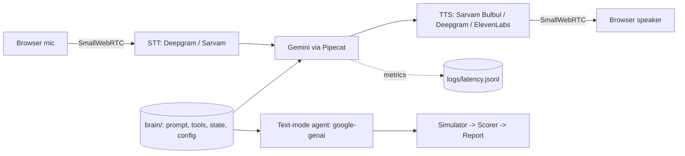

# Arrowhead Project

Hinglish voice AI sales agent for BFSI, plus an automated evaluator. The agent calls (outbound) a
fictional customer for **Vriddhi Finance** (a fictional NBFC) about a pre-approved personal loan.
All names and data in this repo are fictional.

> Status: **Phase 1** (agent brain + browser voice pipeline + latency logging).
> Simulator, scorer and report are stubs (Phase 2/3).

## Architecture



The `brain/` package is shared. Voice and the text-mode simulator use the same system prompt, tool
specs, tool handlers, call state and model settings (all from `config.yaml`).

## Local setup

Requires Python 3.11+ and [uv](https://docs.astral.sh/uv/).

```bash
git clone https://github.com/pragna2334-design/arrowhead-project && cd arrowhead-project
make install                 # creates .venv, installs pinned deps (pipecat-ai==1.12.0)
cp .env.example .env         # then fill in the keys below
```

### Keys

| Variable | Get it at | Used for |
|---|---|---|
| `DEEPGRAM_API_KEY` | https://console.deepgram.com | STT (and Deepgram TTS fallback) |
| `SARVAM_API_KEY` | https://dashboard.sarvam.ai | Bulbul TTS (and optional Sarvam STT) |
| `GOOGLE_API_KEY` | https://aistudio.google.com/apikey | Gemini agent, simulator, judge |
| `ELEVENLABS_API_KEY` | https://elevenlabs.io | optional, only if `tts.provider: elevenlabs` |

### Run the voice bot

```bash
make run-voice               # = python -m voice.bot -t webrtc
```

Open http://localhost:7860/client, click connect, allow the microphone. The agent speaks first.
Use headphones (no echo cancellation tuning here). Per-turn latency is appended to
`logs/latency.jsonl`.

### Configuration (`config.yaml`)

- `stt.provider`: `deepgram` | `sarvam`. `tts.provider`: `sarvam` | `deepgram` | `elevenlabs`.
  They switch independently.
- `brain.agent_model` / `brain.judge_model` are pinned explicitly and must differ (self-grading
  bias: a model scoring its own outputs rates them higher, so the judge is a different model).
- Hindi script: `brain.script: roman` or `devanagari`.
- If Deepgram `language: "multi"` mis-transcribes Hinglish, set it to `"hi"` or switch
  `stt.provider` to `sarvam`.

## Latency definitions

Logged per bot turn in `logs/latency.jsonl` (ms):

| Field | Meaning |
|---|---|
| `e2e_ms` | user silence -> bot starts speaking (what the caller feels) |
| `pipeline_ms` | STT final transcript -> first TTS audio (pipeline only) |
| `stt_ms` | VAD stop -> final transcript |
| `llm_ttfb_ms`, `tts_ttfb_ms` | service time-to-first-byte |

The first line of each call (`kind: greeting`) is timed from client connect; exclude it from turn
percentiles. Target: p50/p95 vs 500 ms for both definitions.

## Known limitations

- Text mode (simulator) runs its own LLM loop with `google-genai`; voice uses Pipecat's
  `GoogleLLMService` loop. Prompt, tools, tool handlers, state, model, temperature and
  token limits are identical, but the loop code is not, so tiny behavioural differences are possible.
- Phase 2/3 pieces (simulator, scorer, report, `make eval`) are not implemented yet.
- See `DECISIONS.md` for assumptions and `# VERIFY:` items that need a live run.
