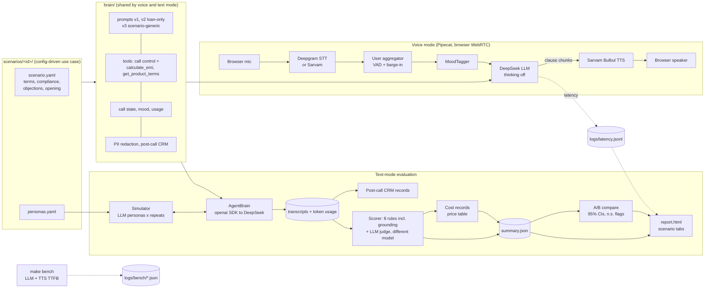

# Arrowhead: Hinglish voice sales agent + evaluator (BFSI)

A real-time Hinglish voice agent for outbound BFSI calls, plus an evaluation harness that tests the
same agent brain against simulated customers, including red-team attackers. Each call is scored
for compliance, grounding, quality, outcome and cost.

The use case is config-driven through **scenario packs**. Three ship with the repo, one per
Arrowhead segment:

| Scenario | Segment | Company (fictional) | Personas |
|---|---|---|---|
| `personal_loan` | Lending | Vriddhi Finance (NBFC) | 25 (5 red-team) |
| `health_insurance_renewal` | Insurance | Kavach General Insurance | 15 (5 red-team) |
| `credit_card_upgrade` | Cards | Udaan Bank | 15 (5 red-team) |

All companies, people, figures and data in this repo are fictional.


## The problem

Voice sales in Indian BFSI must solve five things at once:

| Constraint | Why it is hard | What this repo does |
|---|---|---|
| **Compliance** | Disclose who is calling, never promise approval or claims, stay inside the approved terms, honour do-not-call at once, keep to calling hours. One bad sentence is a regulatory and reputational problem. | Deterministic rule checks on every call, scenario-specific forbidden claims, a red-team suite, versioned prompts with statistically honest A/B comparison, fixed closing lines (the DNC confirmation is always spoken), PII redaction everywhere. |
| **Grounding** | LLMs invent plausible numbers: an EMI, a "special" rate, a premium. Any wrong figure is a mis-selling risk. | Deterministic `calculate_emi` / `get_product_terms` tools. Prompt v3 takes every figure from a tool, and a scorer rule flags any number the agent says that doesn't match a tool result or scenario value. |
| **Hinglish** | Customers switch between Hindi and English mid-sentence. STT, LLM and TTS all have to cope. | Deepgram multilingual STT, Sarvam Bulbul TTS (Indian voices), a prompt that mirrors the customer's language, and a judge dimension for Hinglish fluency. |
| **Latency** | Over ~1 s of silence feels robotic and people talk over the bot. | Streaming Pipecat pipeline, thinking explicitly off, clause-level streaming into TTS, short acknowledgements (v3), barge-in tuned for backchannels, per-turn latency logging, and a repeatable `make bench`. |
| **Unit economics** | A sales agent is only viable if a booked callback costs less than it earns. | Per-call cost from tokens and audio seconds, priced from a config table: cost per call and cost per booked callback. |

## Architecture



## Quick start

### 0. See a report without any keys

```bash
make install        # needs uv: curl -LsSf https://astral.sh/uv/install.sh | sh
make demo-report    # writes demo/report.html from bundled SYNTHETIC data
```

Open `demo/report.html`; on WSL, `explorer.exe demo/report.html`. It shows every section:
scenario tabs, outcomes, compliance, hallucinated figures, cost, a v2-vs-v3 comparison with
confidence intervals and n.s. badges, and latency. Everything in it is labelled synthetic demo
data.

### 1. Keys

```bash
cp .env.example .env    # then fill in the keys below
```

| Variable | Get it at | Used for |
|---|---|---|
| `DEEPGRAM_API_KEY` | https://console.deepgram.com | Speech-to-text (voice) |
| `SARVAM_API_KEY` | https://dashboard.sarvam.ai | Bulbul text-to-speech (voice, `make bench`) |
| `DEEPSEEK_API_KEY` | https://platform.deepseek.com/api_keys | Agent, simulated customers, judge, `make bench` |
| `ELEVENLABS_API_KEY` | https://elevenlabs.io | Optional, only if `tts.provider: elevenlabs` |

The evaluation pipeline needs only `DEEPSEEK_API_KEY`.

### 2. Talk to the agent

```bash
make run-voice                                   # personal_loan, prompt v1
make run-voice PROMPT=v3 SCENARIO=credit_card_upgrade
```

Open http://localhost:7860/client, click Connect and allow the mic. Use headphones.

At startup the bot logs `LLM <model>: thinking=disabled (reasoning off)`. After each call:
- `logs/latency.jsonl` has one line per bot turn.
- `logs/calls/<id>.transcript.json` is the redacted transcript.
- `logs/calls/<id>.postcall.json` is the CRM record.

### 3. Benchmark latency (before/after)

```bash
make bench LABEL=before ARGS="--aggregation sentence"    # Pipecat's sentence chunking
make bench LABEL=after                                   # clause chunking (config default)
make bench-compare BEFORE=logs/bench/before-*.json AFTER=logs/bench/after-*.json
```

The bench streams the real system prompt with fixed customer lines to DeepSeek and sends the
first clause to Sarvam. It records p50/p95 for:
- `llm_ttfb_ms`
- `llm_first_text_ms`
- `llm_first_clause_ms`
- `tts_ttfb_ms`
- `est_first_audio_ms`

It also counts `reasoning_chunks`. Anything above 0 means DeepSeek is still "thinking" despite the
flag.

### 4. Evaluate, then compare prompt versions

```bash
make eval PROMPT=v1 REPEATS=1 ARGS="--n 3"            # smoke run: 3 personas x 1
make eval PROMPT=v1                                    # 25 personas x REPEATS (default 3)
make eval PROMPT=v2
make compare A=v1 B=v2                                 # report.html with 95% CIs
make eval PROMPT=v3 SCENARIO=health_insurance_renewal  # other scenarios need v3+
make report-all PROMPT=v3 A=v2                         # one report, every scenario
```

Each step runs on its own and is resumable:
- `make sim`
- `make postcall`
- `make score`, which never re-simulates and re-prices costs from the current price table
- `make report`

Results are stored per scenario and prompt version in `results/<scenario>/<version>/`, as
`transcripts/`, `postcall/`, `scores/`, `costs/` and `summary.json`.

**Run time.** A call that runs the full 16 customer turns makes at least 33 LLM requests (agent +
customer), plus tool rounds. At the default 8 requests/minute, 25 personas × 3 repeats can take
6–12 hours, plus one judge call per transcript. Start with `REPEATS=1 ARGS="--n 5"`, and raise
`sim.rpm` and `score.rpm` in `config.yaml` if your DeepSeek quota allows. Calls that error (bad
key, network) are excluded from scoring and listed in the summary; re-running `make sim` retries
them.

### Tests

```bash
make test   # offline: stub LLM clients, no network, no keys
make lint
```

CI runs ruff, pytest and `make demo-report` on every push.

## Scenario packs

Each `scenarios/<id>/scenario.yaml` is validated against `schemas/scenario.py` and holds
everything use-case specific:
- **Company and product:** a one-line pitch with no numbers.
- **Terms:** rate band, amount, tenure, fees and other figures. These are the only numbers the
  agent may state.
- **Compliance:** callback hours, required disclosure terms, forbidden-claim regexes, and
  plain-language rules that go into the prompt.
- **Objection playbook:** cue phrases plus how to handle each.
- **Opening line.**

`personas.yaml` sits next to it. To add a use case, copy a pack, edit the YAML, then run
`make eval SCENARIO=<id> PROMPT=v3`.

Prompts v1 and v2 hard-code the loan terms and are kept frozen so their comparison stays clean:
- A test pins their file hashes.
- A second test pins their rendered output.
- They refuse non-loan scenarios.

Prompt v3 is a scenario-generic template. It builds on v2's hardening and adds short
acknowledgements ("Haan ji,", "Ji, samajh gayi.") to cut perceived latency, and it takes figures
only from tools.

## How evaluation works

1. **Simulate** (`sim/`). An LLM plays each persona against `AgentBrain`, the same prompt, tools,
   tool handlers, mood logic and model settings the voice bot uses.
   - Calls run for at most 16 customer turns, with `REPEATS` sampled runs per persona.
   - The simulator handles rate limiting, 429 backoff and resumable runs.
   - Agent and customer token usage is recorded on each redacted transcript.
2. **Post-call** (`brain/postcall.py`). For every call, a deterministic CRM record is built:
   disposition, scenario objection ids, sentiment over the call, consent, next action and callback
   time.
3. **Score** (`score/`):
   - **Deterministic rules:**
     - disclosure (scenario terms)
     - DNC honoured immediately
     - rate inside the band (where the product has one)
     - no guaranteed approval
     - callbacks inside the allowed hours
     - no PII spoken or requested
     - **scenario claims** (forbidden claims per pack)
     - **grounded figures**: every rate, amount, tenure, fee, premium or EMI the agent states must
       match a tool result in that call or a scenario value. Anything else is reported as a
       *hallucinated figure*. The grammar handles Indian formats (5,00,000, 5 lakh, 2.5 lakh),
       Hinglish units (mahine, saal, pratishat) and ranges, and ignores times, dates and the
       closing line.
   - **LLM judge** (1–5 with reasons, on a different model from the agent): objection handling,
     naturalness, empathy and Hinglish fluency.
   - **A red-team verdict** for attack personas.
   - **An outcome** for every call.
4. **Cost** (`score/cost.py`). Each call gets a `CostRecord` priced from `config.yaml → prices`:
   - **LLM:** per role (agent, simulated customer, judge),
     `(prompt − cached) × input + cached × cached_input + completion × output` per 1M tokens.
   - **STT:** `stt_seconds / 60 × per_minute`.
   - **TTS:** `chars / 1000 × per_1k_chars`.
   - Text mode estimates audio from text (14 chars/s spoken, 2.5 words/s heard).
   - *Production cost* = agent LLM + STT + TTS: what a real call would cost. *Eval cost* adds the
     simulated customer and the judge: what running the evaluation costs.
   - The summary reports mean cost per call and **cost per booked callback**.
   - All prices are placeholders to verify against your invoices.
5. **Compare** (`ab/`). Per-call samples from both versions:
   - **Rates** (violation, consent, callback booked, red-team pass, hallucinated-figure call
     rate) get **Wilson 95% intervals** per version and a **Newcombe interval** for the
     difference.
   - **Means** (each judge dimension, cost per call) get a seeded **percentile bootstrap**
     (2,000 resamples).
   - A difference is called significant only when its interval excludes 0. Otherwise the report
     shows a neutral **n.s.** badge and never colours it as a win or a loss.
   - The notes warn when either version has fewer than 30 calls.
6. **Report** (`report/`). A single static file with no JavaScript, and a tab per scenario. It
   covers:
   - outcomes
   - violations with transcript excerpts
   - hallucinated figures
   - judge distributions
   - per-persona and red-team tables
   - cost
   - latency p50/p95 for both definitions against 500 ms
   - the A/B view with confidence intervals

**Latency definitions** (voice, per bot turn):

| Field | Meaning |
|---|---|
| `e2e_ms` | Customer stops speaking → bot starts speaking. This is what the caller feels; it includes the VAD endpointing wait. |
| `pipeline_ms` | STT final transcript → first TTS audio. This is the pipeline only. |
| `stt_ms` | VAD stop → final transcript. |
| `llm_ttfb_ms` | LLM time to first byte. |
| `tts_ttfb_ms` | TTS time to first byte. |

The 500 ms target is realistic for `pipeline_ms` only. End to end, endpointing plus STT alone take
~450 ms.

## Design decisions

The full list is in [DECISIONS.md](DECISIONS.md), and the bug audits are in [AUDIT.md](AUDIT.md).

- **One brain, two modes.** Voice and text mode share the prompt, tool specs and handlers, closing
  lines, mood classifier, call state and model settings. The evaluator therefore tests what the
  voice bot runs.
- **Compliance and figures are never left to the LLM alone.**
  - Callback hours are enforced in the tool.
  - EMI is computed deterministically and refuses rates outside the band.
  - Closing lines are fixed text.
  - Every compliance and grounding check is a deterministic rule; the judge only grades quality.
- **Clause streaming.** Pipecat's sentence aggregator is swapped for a clause chunker:
  - The first clause goes out at 6 characters or more, so "Haan ji," is spoken at once; later
    clauses need 20 characters.
  - Numbers, times and abbreviations are never split.
  - The latency observer's aggregation metric is kept.
- **Barge-in tuned for real calls.**
  - While the bot speaks, two or more words are needed to interrupt.
  - The disclosure greeting always plays in full.
  - The customer is muted during tool calls.
- **Self-grading bias mitigation.**
  - The judge is a different model from the agent, enforced in code.
  - It uses an anchored rubric at temperature 0.
  - It never sees the agent's system prompt.
  - It cannot override the deterministic rules.
- **No over-claiming.** Confidence intervals on every comparison, non-significant differences
  labelled n.s., and caveats (correlated repeats, no multiple-comparison correction) printed in
  the report notes.
- **Simple by design.** No database, no web framework beyond Pipecat's runner and no Docker: just
  folders of JSON validated by frozen pydantic schemas (`schemas/`).

## Limitations

- **Text vs voice loop.** Text mode runs its own LLM loop; voice runs Pipecat's. The prompt,
  tools, handlers, state and model settings are identical, but streaming, interruptions and STT
  errors exist only in voice.
- **Self-grading bias.** It is reduced, not removed. The judge and agent come from the same
  vendor, and simulated customers are more cooperative and articulate than real callers.
- **Statistics.**
  - Repeats of one persona are correlated but treated as independent, so the intervals are
    somewhat narrow.
  - There is no multiple-comparison correction.
  - Personas are not a random sample of real customers.
- **Word lists.** The rules, grounding grammar and mood/objection detectors are keyword-based.
  They miss paraphrases and compound spoken numbers ("saade gyarah", "ek lakh pachaas hazaar"),
  and may flag non-offer numbers of 100 or more.
- **Grounding** checks *values*, not order. A figure counts as grounded if any tool in the call
  returned it, even if the tool was called after the figure was said.
- **Costs.**
  - Prices are placeholders.
  - Text-mode audio seconds are estimated.
  - Voice calls don't record token usage yet, so live-call cost is not computed.
- **Sarvam buffering.** Sarvam buffers `min_buffer_size` characters (50 by default) on its side
  before synthesizing. That may delay a short first clause; try a lower value once verified
  (`tts.sarvam.min_buffer_size`).
- **Redaction is best-effort regex.** Spelled-out numbers, names, addresses and OTPs are not
  masked.
- **Voice transcript timestamps** are synthetic.
- **Fictional compliance.** Compliance rules and figures are illustrative and not legal advice.

## Results

Fill these in after the local runs in [SESSION_HANDOFF.md](SESSION_HANDOFF.md). Report a delta
only where the report says it is significant.

**personal_loan: prompt versions** (25 personas × 3 repeats)

| Metric | v1 | v2 | v3 |
|---|---|---|---|
| Calls | _TBD_ | _TBD_ | _TBD_ |
| Calls with ≥1 compliance violation (95% CI) | _TBD_ | _TBD_ | _TBD_ |
| Calls with a hallucinated figure | _TBD_ | _TBD_ | _TBD_ |
| Red-team pass rate | _TBD_ | _TBD_ | _TBD_ |
| Consent rate | _TBD_ | _TBD_ | _TBD_ |
| Callback booked | _TBD_ | _TBD_ | _TBD_ |
| Judge mean: objection / naturalness / empathy / Hinglish | _TBD_ | _TBD_ | _TBD_ |
| Production cost per call / per booked callback (USD) | _TBD_ | _TBD_ | _TBD_ |

**Scenarios on v3**

| Scenario | Violation rate | Hallucinated figures | Red-team pass | Callback booked | Cost per booked callback |
|---|---|---|---|---|---|
| personal_loan | _TBD_ | _TBD_ | _TBD_ | _TBD_ | _TBD_ |
| health_insurance_renewal | _TBD_ | _TBD_ | _TBD_ | _TBD_ | _TBD_ |
| credit_card_upgrade | _TBD_ | _TBD_ | _TBD_ | _TBD_ | _TBD_ |

**Latency**

| Measure (p50 / p95, ms) | Before (sentence) | After (clause + v3) |
|---|---|---|
| bench `llm_first_clause_ms` | _TBD_ | _TBD_ |
| bench `est_first_audio_ms` | _TBD_ | _TBD_ |
| voice `pipeline_ms` | ~1,175 p50 (one v1 call) | _TBD_ |
| voice `e2e_ms` | ~1,550 p50 (one v1 call) | _TBD_ |

Baseline before these changes, from one v1 voice call: `e2e_ms` p50 ~1,550 and `pipeline_ms` p50
~1,175, with LLM time-to-first-text as the bottleneck.

## Repository layout

```
brain/        shared agent brain: config, scenario loader, prompt builder, tools (call control +
              grounding), finance (EMI/terms), state, mood, usage, redaction, post-call, AgentBrain
prompts/      v1.md, v2.md (frozen, loan-only), v3.md (scenario-generic, grounded, acknowledgements)
scenarios/    <id>/scenario.yaml + personas.yaml for personal_loan, health_insurance_renewal,
              credit_card_upgrade
voice/        Pipecat pipeline, clause chunker + TTS aggregation, thinking flag, mood tagger,
              latency observer
bench/        LLM/TTS latency benchmark (utterances, runner, compare)
sim/          customer simulator, rate limiter, runner
score/        rules, grounding, scenario rules, red-team, judge, cost, runner + summary
ab/           A/B comparison + statistics (Wilson, Newcombe, bootstrap)
report/       static HTML report + synthetic demo data generator
schemas/      frozen pydantic contracts + fixtures
demo/         synthetic demo results + demo/report.html
tests/        offline pytest suite (no network)
```

## Resume summary

> Built a real-time Hinglish voice AI sales agent for BFSI outbound calls (lending, insurance and
> cards), using Pipecat (WebRTC), Deepgram STT, Sarvam Bulbul TTS and DeepSeek.
> - Use cases are config-driven scenario packs.
> - Compliance guardrails are enforced in code, and figures are grounded through deterministic
>   EMI/terms tools.
> - Clause-level TTS streaming cut time to first audio from _X_ ms to _Y_ ms p50.
> - Built an evaluation harness on the same agent brain:
>   - LLM-simulated personas including red-team attacks (prompt injection, data exfiltration,
>     impersonation, abuse, guarantee-baiting)
>   - eight deterministic compliance rules including a hallucinated-figure detector, plus an
>     LLM-as-judge rubric on a separate model
>   - per-call cost accounting (_$C_ per booked callback)
>   - versioned prompts compared with 95% confidence intervals
> - Prompt v3 cut calls with compliance violations from _X_% to _Y_% and hallucinated figures from
>   _A_% to _B_% (significant at 95%).
> - CI-tested with an offline pytest suite (_N_ tests).
